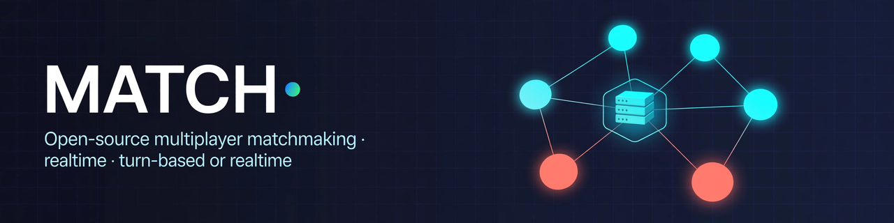

# MATCH

[](https://opensource.org/licenses/MIT)
[](https://www.python.org/downloads/)
[](https://fastapi.tiangolo.com/)
[](#api-reference)
[](#disconnect-time--disconnection_time_sec)
[](#how-matching-works)
[](#turn-based-or-not--choosing-a-mode)
[](https://github.com/EricEisaman/match/pulls)
[](https://github.com/EricEisaman/match/stargazers)

> **One join shape serves every game.**
>
> MATCH is an open-source multiplayer backend for small-to-medium realtime and turn-based games. Clients `join` once with a `GameSessionConfig` — including a `character_schema` that declares the shape of per-player state — then send character state, item state, custom state, and turn actions over REST — and receive the whole game over a single Server-Sent Events (SSE) stream. The server is authoritative for rooms, turns, items, and game data from the first join.

No WebSockets to manage. No background timer loop. No per-game server code for the common cases — tic-tac-toe, top-down collectors, 3D third-person collectors, lobby games, and turn-based board games all speak the same protocol.

**Live demos in this repo:** `GET /tic-tac-toe` · `GET /top-down` · `GET /babylon` · `GET /demo/{name}`

---

## Table of Contents

- [Why MATCH?](#why-match)
- [Features](#features)
- [Quickstart](#quickstart)
- [How it works — architecture](#how-it-works--architecture)
- [Project structure](#project-structure)
- [API Reference](#api-reference)
- [Character state — schema-declared](#character-state--schema-declared)
- [Client protocol — the 60-second version](#client-protocol--the-60-second-version)
- [How Matching Works](#how-matching-works)
- [Turn-Based or Not — Choosing a Mode](#turn-based-or-not--choosing-a-mode)
- [Disconnect Time — `disconnection_time_sec`](#disconnect-time--disconnection_time_sec)
- [Server-authoritative game data & empty-game cleanup](#server-authoritative-game-data--empty-game-cleanup)
- [Config reference](#config-reference)
- [Demos](#demos)
- [Deployment](#deployment)
- [Security & limits](#security--limits)
- [Contributing](#contributing)
- [License](#license)

---

## Why MATCH?

Most multiplayer tutorials stop at “echo positions to everyone.” Real games need more:

| Real-game need | MATCH answer |
|---|---|
| Find fair opponents | Skill-aware matchmaking with widening tolerance, plus direct / private rooms |
| Turn order without cheating | Server-validated `TurnManager`: only the player whose turn it is can act |
| Shared items without duplication | Server-spawned items, authority-gated updates, exactly-once collections |
| Players who vanish mid-game | Event-driven disconnect eviction + synchronizer / authority failover |
| Late joiners | Full bootstrap snapshot on `GET /stream` — characters, items, room, turn state |
| Idle games leaking memory | Empty-game data deleted lazily after `empty_game_ttl_sec` (default 5 min) |
| One backend, many games | `game_id` + `GameSessionConfig` selects matchmaking, turns, authority, TTLs |
| Character state that cannot drift | `character_schema`: every game declares its per-player fields, types, and who may set them — the server validates, drops server-owned fields from client patches, and rejects legacy shapes |

**Design principles**

1. **Server-authoritative.** Clients are renderers + input. The server owns rooms, turns, items, and game data.
2. **Event-driven, never timers.** No `sleep`, no background sweeper. Disconnect and empty-game cleanup run lazily when the *next* packet from *any* client arrives. This makes behaviour deterministic, testable, and cheap on serverless / Render free tiers.
3. **One protocol.** `join` → `stream` → `character-state` / `item-state` / `custom-state` / `turn/action`. If you can `fetch()`, you can multiplayer.
4. **Boring transport.** REST for client → server, SSE for server → client. Works through proxies, load balancers, and browsers with no WebSocket upgrade.
5. **Declared, not guessed, character state.** There is no universal `pos` / `health` / `metadata` shape. Each `game_id` declares its fields in `character_schema`; anything undeclared is rejected, and anything server-owned is dropped from client patches.

---

## Features

- **Skill-aware matchmaking** — rating + widening tolerance, FIFO fairness, `min_players_per_room` / `max_players_per_room`
- **Direct + private rooms** — `room_id` / `room_code`, `visibility: public | private`
- **Turn-based engine** — server-validated actions, pass / resign, draw / win, opponent-left handling
- **Realtime engine** — schema-validated character-state broadcast, dirty filtering, freshness tracking
- **Schema-declared character state** — `character_schema` per `game_id`: types, required, defaults, bounds, client vs server authority, `409` on mismatch, `dropped_server_fields` on client patches that try to set server fields
- **Item authority** — env authority + per-item owners, claim / release, exactly-once collections
- **Server-spawned game data** — e.g. gem games: 24 live gems, respawn 1 per collection, same field for every player, server-authoritative score on collection
- **Disconnect handling** — per-client `disconnection_time_sec`, heartbeat endpoint, `403 disconnected: timeout`, failover
- **Empty-game cleanup** — game data deleted after 5 min empty (lazy, on next packet), including the stored character schema
- **Custom state & effects** — opaque per-room `custom` + `effects-state` for game-specific rules
- **Demos** — turn-based tic-tac-toe, realtime top-down, and 3D third-person Babylon, all against the same API
- **Capabilities endpoint** — `GET /api/v1/capabilities` for clients to feature-detect

---

## Quickstart

### 1. Run locally

```bash
git clone https://github.com/EricEisaman/match.git
cd match
pip install -r requirements.txt   # or: pip install fastapi uvicorn
uvicorn server.app.main:app --reload --port 8000
```

Open:

- http://localhost:8000/ — API index
- http://localhost:8000/tic-tac-toe — turn-based demo
- http://localhost:8000/top-down — realtime 2D demo
- http://localhost:8000/babylon — realtime 3D third-person demo

### 2. Join a game (realtime, no matchmaking)

```bash
curl -s -X POST http://localhost:8000/api/multiplayer/join \
  -H "Content-Type: application/json" \
  -d '{
    "environment_name": "top-down-demo",
    "character_name": "Billy",
    "game_id": "top-down-demo",
    "player_id": "demo-billy",
    "skill": {"rating": 1000},
    "config": {
      "game_id": "top-down-demo",
      "requires_matchmaking": false,
      "requires_turn_based": false,
      "max_players_per_room": 8,
      "min_players_per_room": 1,
      "disconnection_time_sec": 60,
      "empty_game_ttl_sec": 300,
      "character_schema": {
        "version": 1,
        "fields": {
          "position": {"type": "vec2", "required": true, "authority": "client", "semantic": "position"},
          "health": {"type": "int", "required": true, "min": 0, "max": 100, "authority": "client", "semantic": "health"},
          "score": {"type": "int", "authority": "server", "default": 0, "min": 0, "semantic": "score"},
          "name": {"type": "string", "authority": "client", "semantic": "name"},
          "color": {"type": "string", "authority": "client"}
        }
      }
    }
  }'
```

Response (abridged):

```json
{
  "client_id": "a1b2c3d4",
  "session_id": "9f8e7d6c5b4a3921",
  "is_synchronizer": true,
  "room_id": "3224f87452ae",
  "game_id": "top-down-demo",
  "match_status": "ready",
  "disconnection_time_sec": 60.0,
  "character_schema": { "version": 1, "fields": { "...": "..." }, "allow_unknown": false }
}
```

The first join for a `game_id` stores that schema. A later join declaring a different schema gets `409` with `{"error": "character_schema_mismatch", "character_schema": <stored>}` — rejoin once with the stored schema. To change a schema, use a new `game_id` or wait for the empty-game TTL to clear the old game data. See [Character state](#character-state--schema-declared).

### 3. Stream the game

```bash
curl -N "http://localhost:8000/api/multiplayer/stream?session_id=9f8e7d6c5b4a3921"
```

The first SSE event is a full bootstrap: `connection`, `clients`, `characters`, `items`, `room`, `match`, `turnState`, plus the effective `character_schema`. Every later event is a patch: `item-state-update`, `character-state-update`, `client-joined`, `client-left`, `synchronizer-changed`, `env-item-authority-changed`, `game-over`, and so on.

### 4. Send input

```bash
# Move (realtime) — schema shape: {clientId, state: {...}}. Only client-owned fields.
# NEVER send score here: it is server-authoritative and would be dropped.
curl -s -X PATCH http://localhost:8000/api/multiplayer/character-state \
  -H "Content-Type: application/json" -H "X-Client-ID: a1b2c3d4" \
  -d '{"updates":[{"clientId":"a1b2c3d4","state":{"position":[120,340],"health":100,"name":"Billy","color":"#4da3ff"}}],"timestamp":1710000000000}'

# Collect a gem (exactly-once). The server increments the server-authoritative
# score and broadcasts the updated character state with source "server".
curl -s -X PATCH http://localhost:8000/api/multiplayer/item-state \
  -H "Content-Type: application/json" -H "X-Client-ID: a1b2c3d4" \
  -d '{"updates":[],"collections":[{"instanceId":"top-down-demo:gem-1","collectedByClientId":"a1b2c3d4","environment":"top-down-demo"}],"timestamp":1710000000000}'

# Keep-alive (also triggers lazy disconnect / empty-game sweeps)
curl -s -X POST http://localhost:8000/api/multiplayer/heartbeat \
  -H "Content-Type: application/json" -H "X-Client-ID: a1b2c3d4" -d '{}'
```

> All client → server calls after `join` carry `X-Client-ID: <client_id>`. The `stream` call carries `?session_id=<session_id>` instead.
>
> The old shape — top-level `pos` / `position` / `health` / `score` / `metadata` / `velocity` / `facing` on a character update — is rejected with `422`. Send everything inside `state` and declare it in `character_schema`.

### 5. Join a turn-based game (tic-tac-toe)

```bash
curl -s -X POST http://localhost:8000/api/multiplayer/join \
  -H "Content-Type: application/json" \
  -d '{
    "environment_name": "tic-tac-toe",
    "character_name": "X",
    "game_id": "tic-tac-toe",
    "player_id": "player-x",
    "config": {
      "game_id": "tic-tac-toe",
      "requires_matchmaking": true,
      "requires_turn_based": true,
      "max_players_per_room": 2,
      "min_players_per_room": 2,
      "turn": {"max_turns": 9, "allow_pass": false, "allow_resign": true},
      "character_schema": {"version": 1, "fields": {}}
    }
  }'
```

Tic-tac-toe sends no character state, so its schema is empty (`fields: {}`). Omitting `character_schema` entirely means the same thing: an empty schema. Then play with `POST /api/multiplayer/turn/action` — see [Turn-Based or Not](#turn-based-or-not--choosing-a-mode).

---

## How it works — architecture

```
                    ┌────────────────────────────┐
  Browser / Client  │  join()                      │
  ───────────────►  │  POST /api/multiplayer/join │
                    │  → room + authority +       │
                    │    server game data +       │
                    │    character_schema         │
                    └──────────────┬─────────────┘
                                   │ bootstrap
                    ┌──────────────▼─────────────┐
                    │  GET /api/multiplayer/stream │
                    │  SSE: full snapshot, then   │
                    │  patches (Datastar signals) │
                    └──────────────┬─────────────┘
                                   │
        ┌──────────────────────────┼──────────────────────────┐
        │                          │                          │
  PATCH /character-state   PATCH /item-state          POST /turn/action
  PATCH /custom-state      PATCH /item-authority-*    POST /turn/pass|resign
  PATCH /effects-state     POST /heartbeat            POST /switch-environment
        │                          │                          │
        └──────────────────────────┼──────────────────────────┘
                                   ▼
                    ┌────────────────────────────┐
                    │  MultiplayerRegistry       │
                    │  clients · rooms · authority│
                    │  character_cache · item_cache│
                    │  game_character_schemas     │
                    │  TurnManager · Matchmaker  │
                    │  DirtyFilter · Freshness   │
                    │  ────────────────────────── │
                    │  On EVERY packet:           │
                    │  1. touch sender            │
                    │  2. sweep expired clients   │
                    │  3. sweep empty games       │
                    │  4. apply + broadcast       │
                    └────────────────────────────┘
```

**Key invariants**

- The server never trusts a client about *who* may act, *whose* turn it is, or *whether* an item exists. It validates and then broadcasts.
- The server never trusts a client about the *shape* of character state. The first join for a `game_id` declares it; every patch is validated against it.
- The first packet for a game creates the game data. The last client leaving starts a 5-minute grace clock. The next packet after the clock expires deletes the data — including the stored character schema.
- Every packet is a “tick.” There is no wall-clock loop.

### Project structure

```
match/
├── README.md
├── docs/
│   └── hero.png                  # 1280×320 hero (raw GitHub link at top of README)
├── server/
│   └── app/
│       ├── main.py               # FastAPI app, demos, /api/multiplayer router, registry glue
│       ├── multiplayer/
│       │   ├── protocol.py       # GameSessionConfig, CharacterSchema, JoinRequest/Response, signals, validation
│       │   ├── authority.py      # AuthorityManager — env + per-item ownership, failover
│       │   ├── matchmaking.py    # Matchmaker — queues, fingerprint, skill tolerance
│       │   ├── turns.py          # TurnManager — phases, order, pass/resign, win/draw
│       │   └── ...               # DirtyFilter, FreshnessMatrix, SkillProvider
│       └── demo/
│           ├── tic-tac-toe.html  # turn-based demo (empty character schema)
│           ├── top-down.html     # realtime 2D demo (server-spawned gems, server score)
│           ├── babylon.html      # realtime 3D third-person demo (same gem protocol, yaw + anim)
│           └── hulk.glb          # model loaded by babylon.html
└── extension/
    └── manifest.json
```

> Your checkout may have additional `api/` / `chat` / `health` routers in `main.py`. The multiplayer surface below is the stable contract; other routers are auxiliary.

---

## API Reference

Base: `https://<your-host>/api/multiplayer`

All timestamps are **milliseconds since epoch** (`_now_ms()`). All client → server calls after `join` require `X-Client-ID`. Errors are FastAPI `HTTPException` JSON: `{"detail": "..."}`. Character-state errors use `422` for malformed / undeclared / legacy shapes and `409` for schema mismatch on join (see [Character state](#character-state--schema-declared)).

### Session & matchmaking

| Method | Path | Purpose |
|---|---|---|
| `POST` | `/join` | Create a client, assign room / queue, register authority, ensure server game data, store or check `character_schema`. Returns `client_id`, `session_id`, `is_synchronizer`, `room_id`, `disconnection_time_sec`, `character_schema`. |
| `POST` | `/leave` | Remove client, fail over synchronizer / authority, start empty-game clock if env is now empty. |
| `POST` | `/heartbeat` | Explicit keep-alive. Touches `last_seen_ms`, sweeps expired + empty games. Returns `403` if already evicted. |
| `POST` | `/matchmaking/cancel` | Remove client from queue. |
| `GET` | `/matchmaking/status?client_id=…` | Queue position / status for a queued client. |
| `POST` | `/switch-environment` | Move client to another `environment_name`. Old env may become empty; new env gets game data + authority. |
| `GET` | `/stream?session_id=…` | SSE stream. First event = full bootstrap. Later events = patches. |

### Realtime state

| Method | Path | Purpose |
|---|---|---|
| `PATCH` | `/character-state` | Broadcast schema-declared per-player state for one or more clients. See [Character state](#character-state--schema-declared). Server validates against the game’s schema, merges patches into the stored full state, drops server-owned fields from client patches, and broadcasts the merged full state. |
| `PATCH` | `/item-state` | `updates` (move / spawn — authority-gated) + `collections` (exactly-once, any player). For server-spawned gems, updates are dropped; only collections are accepted, and each collection respawns one gem + increments the collector’s server-authoritative score. |
| `PATCH` | `/item-authority-claim` | Claim authority over a single item (if `allow_client_claims`). |
| `PATCH` | `/item-authority-release` | Release a claim. |
| `PATCH` | `/custom-state` | Opaque per-room `custom` dict — game-specific rules, scores, timers, flags. |
| `PATCH` | `/effects-state` | Visual / audio effects state (particles, shakes, flashes) broadcast to the room. |

### Turn-based

| Method | Path | Purpose |
|---|---|---|
| `POST` | `/turn/action` | Submit a turn action. Server validates it is your turn, the room is `in_progress`, and the action is legal for your validator. |
| `GET` | `/turn/state?room_id=…` | Current `TurnState`: phase, turn order, current player, winner, draw. |
| `POST` | `/turn/pass` | Pass your turn (if `allow_pass`). |
| `POST` | `/turn/resign` | Resign. Opponent wins (if in progress). |

### Meta / demos

| Method | Path | Purpose |
|---|---|---|
| `GET` | `/api/v1/capabilities` | Feature flags the client can detect (`disconnectionTime`, `heartbeat`, `turns`, etc.). |
| `GET` | `/` | API index / health. |
| `GET` | `/tic-tac-toe` | Turn-based demo. |
| `GET` | `/top-down` | Realtime 2D demo (also at `/demo/top-down`). |
| `GET` | `/babylon` | Realtime 3D third-person demo (also at `/demo/babylon`, `/babylon.html`, `/demo/babylon.html`). Serves `babylon.html` + `hulk.glb`. |
| `GET` | `/demo/{name}` | Any demo in `server/app/demo/{name}.html`. |
| `GET` | `/extension/manifest.json` | Extension manifest. |

### `POST /join` — request shape

```jsonc
{
  "environment_name": "top-down-demo",   // namespace: one game = one environment
  "character_name": "Billy",
  "game_id": "top-down-demo",
  "player_id": "stable-player-id",        // for skill lookup; "" = anonymous
  "display_name": "Billy",
  "skill": { "rating": 1000 },
  "room_id": null,                       // or join a specific room
  "room_code": null,                     // or join a private room by code
  "config": {
    "game_id": "top-down-demo",
    "requires_matchmaking": false,
    "requires_turn_based": false,
    "max_players_per_room": 8,
    "min_players_per_room": 1,
    "visibility": "public",               // "public" | "private"
    "room_code": null,
    "matchmaking": {
      "max_initial_skill_gap": 100.0,
      "gap_widen_per_sec": 5.0,
      "max_skill_gap": 500.0
    },
    "turn": {
      "max_turns": null,
      "allow_pass": true,
      "allow_resign": true,
      "turn_order_strategy": "join_order"
    },
    "authority": {
      "scopes": ["items", "environment", "character_state"],
      "resource_types": ["*"],
      "allow_client_claims": true
    },
    "character_schema": {
      "version": 1,
      "fields": {
        "position": {"type": "vec2", "required": true, "authority": "client", "semantic": "position"},
        "health": {"type": "int", "required": true, "min": 0, "max": 100, "authority": "client", "semantic": "health"},
        "score": {"type": "int", "authority": "server", "default": 0, "min": 0, "semantic": "score"},
        "name": {"type": "string", "authority": "client", "semantic": "name"},
        "color": {"type": "string", "authority": "client"}
      }
    },
    "disconnection_time_sec": 60,
    "empty_game_ttl_sec": 300,
    "custom_rules": {},
    "metadata": {}
  }
}
```

`environment_name` defaults to `game_id` if omitted. `config` is parsed by `GameSessionConfig.from_payload()` and accepts flat aliases (`maxPlayersPerRoom`, `disconnectionTime`, `emptyGameTtlSec`, …) as well as nested shapes. Omitting `character_schema` declares the empty schema (no character state — correct for tic-tac-toe).

### `GET /stream` — SSE wire format

`Content-Type: text/event-stream`. Events are Datastar `datastar-patch-signals`:

```
event: datastar-patch-signals
data: signals {"mp": {"connection": {...}, "characters": [...], "items": {...}, "room": {...}}}
```

Clients should handle two forms:

- **Bootstrap** (first event): full snapshot — `connection`, `clients`, `characters`, `items.updates`, `room`, `custom`, `turnState`, `match`, `character_schema`.
- **Patch** (later events): a single signal name — `item-state-update`, `character-state-update`, `client-joined`, `client-left`, `synchronizer-changed`, `env-item-authority-changed`, `item-authority-changed`, `game-over`, `matchmaking-queued`, etc.

Demo clients parse with:

```js
const stream = new EventSource(`/api/multiplayer/stream?session_id=${sessionId}`);
stream.addEventListener("datastar-patch-signals", (ev) => handleStreamData(ev.data));
stream.onmessage = (ev) => handleStreamData(ev.data);
```

### `PATCH /character-state` — shape

```jsonc
{
  "updates": [
    {
      "clientId": "a1b2c3d4",
      "state": {
        "position": [120.5, 340.0],
        "health": 100,
        "name": "Billy",
        "color": "#4da3ff"
        // NEVER "score" here — it is server-authoritative (see below)
      }
      // "timestamp" is accepted but ignored; the server stamps receipt time.
      // "source" is accepted but ignored; the caller decides source.
    }
  ],
  "timestamp": 1710000000000 // accepted but ignored
}
```

Response:

```jsonc
{
  "ok": true,
  "accepted": [{ "clientId": "a1b2c3d4", "state": { "...": "merged full state" }, "source": "client", "timestamp": 1710000000123 }],
  "dropped_server_fields": { "a1b2c3d4": ["score"] }, // only when the patch tried to set server fields
  "server_timestamp": 1710000000123
}
```

Broadcast characters (bootstrap + `character-state-update`) are full merged states:

```jsonc
{ "clientId": "a1b2c3d4", "state": { "position": [120.5, 340.0], "health": 100, "score": 3, "name": "Billy", "color": "#4da3ff" }, "source": "client" }
{ "clientId": "a1b2c3d4", "state": { "position": [120.5, 340.0], "health": 100, "score": 4, "name": "Billy", "color": "#4da3ff" }, "source": "server" }
```

### `PATCH /item-state` — shape

```jsonc
{
  "updates": [
    {
      "instanceId": "top-down-demo:gem-1",
      "itemName": "gem",
      "pos": [120.5, 340.0],
      "rot": [0, 0, 0, 1],
      "isCollected": false,
      "environment": "top-down-demo"
    }
  ],
  "collections": [
    {
      "instanceId": "top-down-demo:gem-1",
      "collectedByClientId": "<client_id>",
      "environment": "top-down-demo"
    }
  ],
  "timestamp": 1710000000000
}
```

- `instanceId` should be namespaced: `<environment>:<local-id>`. Bare ids bind to the sender’s env on first sight.
- `updates` are **authority-gated** — non-owners are silently dropped (per spec §7.5). No error, no broadcast.
- `collections` are **any-player, exactly-once** — the first valid collection wins; later duplicates are dropped; a collected item cannot be resurrected by a stale update (except by the env authority respawning it, or by the server respawning a gem).
- For gem games (`top-down-demo`, `babylon-demo`), the server owns gems: client `updates` for gems are dropped, `collections` trigger a server respawn + a server-authoritative score increment in the same broadcast.

---

## Character state — schema-declared

### Why a schema?

Before the schema, every game invented its own top-level character shape — `pos` here, `position` there, `metadata: {health, name}` somewhere else — and the server relayed whatever it got. A client that sent `score` could set its own score. A client that sent a new field could break every other client’s renderer. The schema fixes that: **one declared shape per `game_id`, validated by the server, with authority per field.**

Rules in one paragraph: the only universal top-level character field is `clientId`. Everything else lives inside `state` and must be declared in `config.character_schema` on join. The first join for a `game_id` stores the schema; a later join with a different schema gets `409` + the stored schema. Patches are partial — a client may send one field at a time — and `required` is enforced on the merged full state, not on the patch. Client patches that include a server-owned field have that field dropped (reported in `dropped_server_fields`), never broadcast. Unknown fields are rejected (`422`) unless the schema opts into `allow_unknown`. Legacy top-level shapes (`position`, `health`, `velocity`, `score`, `metadata`, `pos`, … outside `state`) are rejected outright (`422`).

### Declaring a schema

```jsonc
{
  "version": 1,                       // part of the schema identity: same fields, different version = mismatch (409)
  "allow_unknown": false,             // default false = closed schema; true = relay unknown fields unvalidated (prototyping only)
  "fields": {                         // alias: "properties" is also accepted
    "position": {"type": "vec2", "required": true, "authority": "client", "semantic": "position"},
    "health": {"type": "int", "required": true, "min": 0, "max": 100, "authority": "client", "semantic": "health"},
    "score": {"type": "int", "authority": "server", "default": 0, "min": 0, "semantic": "score"},
    "name": {"type": "string", "authority": "client", "semantic": "name"}
  }
}
```

| Field key | Meaning |
|---|---|
| `type` | Required. One of `string`, `int`, `number`, `bool`, `enum`, `vec2`, `vec3`. |
| `required` | Default `false`. Enforced on the merged full state, not on a patch. |
| `default` | Value filled in when a field is missing from the merged state. `null` means “no default” — `null` is never a valid value for any field type. |
| `min` / `max` | Numeric bounds for `int` / `number`, per-component bounds for `vec2` / `vec3`, length bounds for `string`. Aliases: `min_value` / `minimum`, `max_value` / `maximum`. Not meaningful for `bool` / `enum`. |
| `values` | Only for `enum`. Non-empty list of string / number values. Alias: `enum_values`. |
| `authority` | `"client"` (default) or `"server"`. Alias: `"server_only": true` means `authority: "server"`. |
| `semantic` | Optional hint for generic tools (lobby, spectator, debug UI): e.g. `"position"`, `"health"`, `"score"`, `"name"`. Free-form string, not validated beyond non-empty. |

Limits: at most 64 fields per schema, at most 64 keys and 8192 bytes per patch. Field names may not be the reserved `clientId`, `state`, `timestamp`, `source`.

Validation / normalization: `number` becomes `float`; `vec2` / `vec3` become lists of floats of exactly 2 / 3 numbers; `int` must be a real integer (booleans are rejected); `enum` values are not coerced; `bool` must be a real boolean; `string` length is checked against `min` / `max` when set.

### Who may set what — client vs server authority

| Authority | Who sets it | Client patch containing it | Example |
|---|---|---|---|
| `client` | Any client, for its own `clientId` | Accepted, validated, broadcast | `position`, `health`, `name`, `yaw`, `anim` |
| `server` | Server code only (internal server-set path) | Dropped, listed in `dropped_server_fields`, never broadcast | `score` in the gem games |

The canonical server-owned field today is `score` in the gem games: the client never sends it, never increments it locally. On collection the server increments it through the server-set path and broadcasts the updated full state with `source: "server"`. That broadcast is the only way the client learns its new score. The synchronizer is still a client — it must go through `validate_client_patch` like everyone else.

`timestamp` and `source` from the client are ignored: the server stamps receipt time, and the caller decides `source` (`"client"` for client patches, `"server"` for server-set patches).

### First join wins, two enforcements

1. **Registry (`409`):** one stored schema per `game_id`, regardless of room / `room_code`. A later join with a different schema (fields, `version`, or `allow_unknown` differ) gets `409` + the stored schema and creates no session, no room, no synchronizer. The demos retry once with the stored schema.
2. **Matchmaking fingerprint:** the schema’s canonical hash is part of `GameSessionConfig.fingerprint()`, so two clients that declared different schemas never matchmake together in the first place.

To change a schema, use a new `game_id` or wait for the empty-game TTL to clear the old game data (empty-game deletion deletes the stored schema with the game).

### The three shipped schemas

**Top-down** (`top-down-demo`) — 2D realtime collector:

```jsonc
{ "version": 1, "fields": {
  "position": {"type": "vec2", "required": true, "authority": "client", "semantic": "position"},
  "health": {"type": "int", "required": true, "min": 0, "max": 100, "authority": "client", "semantic": "health"},
  "score": {"type": "int", "authority": "server", "default": 0, "min": 0, "semantic": "score"},
  "name": {"type": "string", "authority": "client", "semantic": "name"},
  "color": {"type": "string", "authority": "client"}
} }
```

**Babylon** (`babylon-demo`) — 3D third-person collector, same gem protocol, plus orientation / animation:

```jsonc
{ "version": 1, "fields": {
  "position": {"type": "vec2", "required": true, "authority": "client", "semantic": "position"},
  "health": {"type": "int", "required": true, "min": 0, "max": 100, "authority": "client", "semantic": "health"},
  "score": {"type": "int", "authority": "server", "default": 0, "min": 0, "semantic": "score"},
  "name": {"type": "string", "authority": "client", "semantic": "name"},
  "color": {"type": "string", "authority": "client"},
  "yaw": {"type": "number", "authority": "client"},
  "anim": {"type": "string", "authority": "client"}
} }
```

Babylon and top-down are different `game_id`s with different schemas and different gem fields (`babylon-demo:gem-N` vs `top-down-demo:gem-N`) — they never share gems or character state. Babylon is a 3D third-person game, not a top-down game; it shares the gem mechanic, not the camera.

**Tic-tac-toe** (`tic-tac-toe`) — turn-based, no character state:

```jsonc
{ "version": 1, "fields": {} }
```

### Client handling — partial-safe, own-state is the score channel

Server broadcasts are full merged states, but a client must still handle them as if they could be partial: only fields present in a broadcast overwrite the stored value; missing fields keep their previous value. A server-only score broadcast is the one case where this matters in practice — the demos’ `applySelfCharacter()` takes `score` (and `health`) from their own entry and never overwrites their own position from their own echo, and `upsertRemote()` only overwrites remote fields actually present.

Do not do what the old demos did:

```js
// WRONG (old demos): local score increment on collection — double-counts,
// because the server already incremented it and will broadcast it.
me.score += 1;

// WRONG (old demos): sending score, metadata, velocity, facing, characterModelId
updates: [{ clientId, position: [x, y], score: me.score, metadata: { health, name } }]
// → 422 (legacy shape) and/or dropped_server_fields: ["score"]

// RIGHT: send only client-owned fields inside state; learn score from the broadcast.
updates: [{ clientId, state: { position: [x, y], health, name, color } }]
```

### Failure modes

| Symptom | Likely cause | Fix |
|---|---|---|
| Join `409` `character_schema_mismatch` | Another client already stored a different schema for this `game_id` | Rejoin with the `character_schema` from the `409` body (demos do this once) |
| PATCH `422` `unknown character field: X` | `X` is not in the schema | Declare `X` in the schema (new `game_id`) or stop sending it |
| PATCH `422` legacy shape | Top-level `position` / `health` / `metadata` / `velocity` / … outside `state` | Move everything inside `state` |
| `dropped_server_fields: ["score"]` | Patch tried to set a server-owned field | Stop sending `score`; read it from the `source: "server"` broadcast |
| `422` `missing required character fields` | Merged full state lacks a `required` field with no default | Send the field at least once, or give it a `default` |
| Two players never match | Fingerprint mismatch — including different `character_schema` | Log `config.fingerprint()` on both clients, diff them |
| Score never changes / double-counts | Client increments locally instead of reading the server broadcast | Remove the local increment; apply `applySelfCharacter()` on the broadcast |

---

## Client protocol — the 60-second version

1. **Join** — `POST /join` with `GameSessionConfig`, including `character_schema`. Save `client_id` + `session_id`. On `409`, rejoin once with the stored schema from the error body.
2. **Stream** — `GET /stream?session_id=…`. Render the bootstrap, then apply patches.
3. **Send input on your own cadence** — e.g. `requestAnimationFrame` for realtime, on-click for turn-based. No server tick to keep up with. Send `{clientId, state: {...}}` with only client-owned, schema-declared fields.
4. **Heartbeat** — if your game has long idle periods (lobby, thinking, paused), `POST /heartbeat` at least once per `disconnection_time_sec / 2`.
5. **Leave** — `POST /leave` on unload / quit. If you don’t, the server evicts you on the next packet after your budget expires.

```js
// Minimal JS client (see server/app/demo/top-down.html for a full one)
const joinRes = await fetch("/api/multiplayer/join", {
  method: "POST",
  headers: { "Content-Type": "application/json" },
  body: JSON.stringify({
    environment_name: "my-game",
    character_name: "Ada",
    game_id: "my-game",
    config: {
      game_id: "my-game",
      requires_matchmaking: false,
      requires_turn_based: false,
      character_schema: {
        version: 1,
        fields: {
          position: { type: "vec2", required: true, authority: "client", semantic: "position" },
          name: { type: "string", authority: "client", semantic: "name" }
        }
      }
    }
  })
});
const { client_id, session_id } = await joinRes.json();

const stream = new EventSource(`/api/multiplayer/stream?session_id=${session_id}`);
stream.addEventListener("datastar-patch-signals", (e) => applyPatch(JSON.parse(e.data.slice("signals ".length))));

await fetch("/api/multiplayer/character-state", {
  method: "PATCH",
  headers: { "Content-Type": "application/json", "X-Client-ID": client_id },
  body: JSON.stringify({ updates: [{ clientId: client_id, state: { position: [10, 20], name: "Ada" } }], timestamp: Date.now() })
});
```

---

## How Matching Works

Matching answers one question: **which players should share a room, and in what order?**

MATCH supports two paths that share the same `join` shape. The choice is `requires_matchmaking` in `GameSessionConfig`.

### The two paths

|  | Direct rooms (`requires_matchmaking: false`) | Matchmaking (`requires_matchmaking: true`) |
|---|---|---|
| **Use for** | Friends joining a lobby, private codes, single-player + spectators, demos, any game where *who* you play with matters more than fairness | Ranked / casual queues, strangers, skill-balanced rooms |
| **Room creation** | First joiner creates a room for `environment_name` immediately. Later joiners append until `max_players_per_room`. | Joiner is queued. Rooms form only when enough queued players are mutually compatible. |
| **Room id** | Deterministic from `environment_name` (`direct:<env>`) | New UUID per formed match |
| **Latency to play** | Immediate | Waits for a match (see tolerance widening below) |
| **Example** | `top-down-demo`, `babylon-demo` (drop-in) | `tic-tac-toe` (2 players, 1v1) |

Both paths converge on the same `Room` object: `player_ids`, `status: waiting | in_progress | finished`, `custom`, `turn_manager` (if turn-based).

### Fingerprint — what makes two players matchable?

`GameSessionConfig.fingerprint()` is the matchmaking key. Two players can only be matched if their fingerprints are **identical**:

- `game_id`
- `requires_matchmaking`, `requires_turn_based`
- `max_players_per_room`, `min_players_per_room`
- `matchmaking` tolerances + `game_mode` + `region`
- `turn` rules (`max_turns`, `allow_pass`, `allow_resign`, `turn_order_strategy`)
- `authority` scopes / resource types
- `visibility`, `room_code`, `custom_rules`
- `character_schema` (via its canonical hash — so different schemas never matchmake together; the registry’s one-schema-per-`game_id` `409` is the second enforcement)

Deliberately **excluded**: `disconnection_time_sec` and `empty_game_ttl_sec`. Those are per-client / per-env hygiene budgets, not match compatibility. Two players with different disconnect budgets can still play together — each is evicted on their own budget.

> If two players “should” match but don’t, check the fingerprint first. A single differing field (`turn_order_strategy`, `game_mode`, `room_code`, `character_schema`) silently puts them in different queues.

### Skill-aware matching — the algorithm

Each player has a `SkillRating` (`rating`, e.g. 1000). The source is `SkillProvider.resolve_skill()` — client-reported by default, swappable for a server-side rating store.

`Matchmaker.try_form_matches(fingerprint)` runs on every enqueue / queue fill:

```
1. Pool = queued players for this fingerprint, sorted by enqueued_at_ms (FIFO).
2. While len(pool) >= min_players_per_room:
     oldest = pool[0]                                   # longest waiter is anchor
     waited_ms = now - oldest.enqueued_at_ms
     tolerance = tolerance_for_wait_ms(waited_ms)        # widens over time
     candidates = [p in pool[1:] if |p.skill - oldest.skill| <= tolerance]
     candidates.sort(by |skill diff|)
     group = [oldest] + candidates[:need - 1]            # need = max_players_per_room
     if len(group) < min_players_per_room: break         # wait for more players
     remove group from pool, form a Room for group
3. Leftover pool stays queued.
```

#### Tolerance widening

```python
# MatchmakingConfig
tolerance_for_wait_ms(waited_ms) = min(
    max_skill_gap,
    max_initial_skill_gap + gap_widen_per_sec * (waited_ms / 1000)
)
```

| Config | Default | Meaning |
|---|---|---|
| `max_initial_skill_gap` | `100.0` | At `t = 0`, only players within ±100 rating can match |
| `gap_widen_per_sec` | `5.0` | Tolerance grows +5 rating per second waited |
| `max_skill_gap` | `500.0` | Hard cap — never match players >500 apart, however long they wait |

**Worked example** — `min = 2, max = 2`, `max_initial_gap = 100`, `widen = 5/s`, `max_gap = 500`:

- `t = 0s`: Alice (1000) + Bob (1050) → gap 50 ≤ 100 → **match immediately**.
- `t = 0s`: Carol (1000) + Dave (1300) → gap 300 > 100 → **both wait**.
- `t = 40s`: tolerance = 100 + 5×40 = 300 → gap 300 ≤ 300 → **match**.
- `t = 100s`: tolerance would be 600, capped at 500 → a 600-gap pair **never** matches.

This is the classic fairness-vs-wait tradeoff: tight at first for fair games, looser over time so no one waits forever, capped so a beginner never faces a grandmaster.

#### FIFO fairness + closest-skill selection

- **Anchor = oldest waiter.** The longest-waiting player is never skipped. This prevents starvation: a 900-rated player at the back of a 1500-rated queue cannot be leapfrogged forever.
- **Candidates = closest skill first.** Among players within tolerance, the closest ratings are picked first, so the formed room is as balanced as possible.
- **Group size = up to `max_players_per_room`.** For 2-player games, `group = [oldest, closest]`. For 4-player free-for-alls, the anchor + 3 closest within tolerance.

#### Seats, turn order, and queue position

- `seat` = index in `room.player_ids` (join / formation order). For turn-based games, `TurnManager` derives `turn_order` from `seat` by default (`turn_order_strategy: join_order`).
- `GET /matchmaking/status` returns `queuePosition` (1-based). Position is FIFO, not skill — a high-rated player behind you does not jump you.
- `POST /matchmaking/cancel` removes you from the queue. If you disconnect while queued, the next packet’s sweep cancels you automatically.

### Private rooms & room codes

- `visibility: "private"` + `room_code: "friends-only"` — only joiners who supply the same `room_code` share a room. The fingerprint includes `room_code`, so `room_code: "a"` and `room_code: "b"` are different queues / rooms even for the same `game_id`.
- `room_id` — join a specific existing room (friend invite). If the room is full or finished, join is rejected / a new room is formed depending on the router logic — clients should handle `match_status: queued` vs `ready`.
- `custom_rules` — opaque game-specific rules (e.g. `{"board_size": 3, "time_control": "blitz"}`) are part of the fingerprint, so “3×3 blitz” and “5×5 bullet” never mix.

### Failure modes to design for

| Symptom | Likely cause | Fix |
|---|---|---|
| Two players never match | Fingerprint mismatch (different `turn` / `game_mode` / `room_code` / `custom_rules` / `character_schema`) | Log `config.fingerprint()` on both clients, diff them |
| Long queue, no match | Tolerance cap too low, or `min_players_per_room` > queue size | Lower `max_skill_gap` cap is a *maximum*, not a target — raise it, or lower `min_players` |
| Unfair match | `max_initial_skill_gap` too wide | Tighten to 50–100 for ranked, 200+ for casual |
| Player stuck in queue after tab close | No packet arrived to sweep them | Queue is swept on the next packet from any client; heartbeat from other players unblocks it |
| Same player matched twice | Double `join` (e.g. React StrictMode) | Dedupe by `player_id` on the client, or call `leave` before re-joining |
| Join `409` `character_schema_mismatch` | Different schema for the same `game_id` | Rejoin with the stored schema from the `409` body |

### Tuning cheat-sheet

| Game type | `min` / `max` | `max_initial_gap` | `gap_widen_per_sec` | `max_skill_gap` |
|---|---|---|---|---|
| 1v1 ranked (chess-like) | 2 / 2 | 75 | 2 | 200 |
| 1v1 casual | 2 / 2 | 150 | 8 | 400 |
| 4-player FFA | 4 / 4 | 100 | 5 | 300 |
| Co-op (skill matters less) | 2 / 4 | 300 | 10 | 500 |
| Party / friends | — use direct rooms, not matchmaking — | — | — | — |

---

## Turn-Based or Not — Choosing a Mode

`requires_turn_based` is the single most consequential option in `GameSessionConfig`. It changes what the server validates, what the client must send, and what “cheating” even means.

### At a glance

|  | Realtime (`requires_turn_based: false`) | Turn-based (`requires_turn_based: true`) |
|---|---|---|
| **Examples** | Top-down collector, Babylon 3D collector, shooters, racing, sandbox, party games | Tic-tac-toe, chess, checkers, card games, word games |
| **Who decides order?** | Nobody — everyone acts whenever they want | Server — `TurnManager` enforces `turn_order` |
| **Client sends** | `character-state` every frame / tick, `item-state` collections | `turn/action` only on your turn, plus `turn/pass`, `turn/resign` |
| **Server validates** | Authority for items, disconnect, env binding, character-schema shape + authority | + Is it your turn? Is the room `in_progress`? Is the action legal for your validator? |
| **State broadcast** | Patches as they arrive | `turnState` patch + `game-over` when finished |
| **Idle players** | Kicked by `disconnection_time_sec` if silent | Same — but see “thinking time” below |
| **Best for** | Continuous movement, reflexes, simultaneous play | Discrete moves, strategy, async / slow play, anti-cheat |

You can mix them: a turn-based game can still send `character-state` for cursors / hover / avatars (declared in its schema), and a realtime game can use `custom-state` for scores. The flag only controls whether `TurnManager` gates actions.

### Turn-based in detail

#### `TurnConfig`

```python
TurnConfig(
    enabled=True,                  # == requires_turn_based
    max_turns=None,                # None = unlimited; 9 for tic-tac-toe
    allow_pass=True,               # can a player pass instead of moving?
    allow_resign=True,             # can a player resign?
    turn_order_strategy="join_order"  # join_order | skill | random | custom
)
```

#### `TurnManager` lifecycle

```
waiting ──(min_players join)──▶ in_progress ──(win / draw / resign / max_turns)──▶ finished
                                  ▲
                                  │  turn/action (valid)
                                  │  turn/pass (if allow_pass)
                                  └────────────────────────────────────────────
```

- **`waiting`**: Room exists, not enough players yet. `turn/action` is rejected.
- **`in_progress`**: `current_player_id` = `turn_order[current_index]`. Only that player’s `turn/action` is accepted. After a valid action, the index advances (wrapping), `turn_count += 1`.
- **`finished`**: `winner_id` or `is_draw` is set. Further actions are rejected. `game-over` is broadcast with `turnState`, `winnerId`, `isDraw`, `endReason`.

`GET /turn/state` returns the current `TurnState` — clients should render from this, not from local move history.

#### What is a “turn action”?

```bash
POST /api/multiplayer/turn/action
X-Client-ID: <client_id>

{
  "room_id": "abc123",
  "action": {"cell": 4, "mark": "X"},   # game-specific, opaque to MATCH
  "timestamp": 1710000000000
}
```

MATCH validates *turn ownership*, not game rules — unless you plug in a validator. `MultiplayerRegistry.VALIDATORS` maps `game_id → validator(action, turnState, custom)`. The built-in tic-tac-toe validator checks: cell in `0..8`, cell empty, mark matches the player’s seat. If you don’t register a validator, MATCH accepts any action from the player whose turn it is — suitable for prototyping, not for ranked play.

> **Rule of thumb:** If a move can be faked to win (e.g. “I place X in all 9 cells”), register a validator. If the move is just “I ended my turn,” the turn gate alone is enough.

#### Pass / resign

| Endpoint | When to use | Effect |
|---|---|---|
| `POST /turn/pass` | “I have no move” (card games, blocked positions) | Advances turn without an action, if `allow_pass`. Otherwise `400`. |
| `POST /turn/resign` | “I give up” | Room → `finished`, opponent wins, `endReason: resign`, `game-over` broadcast. If `allow_resign` is false, rejected. |

#### Opponent leaves mid-game

If a player leaves / times out while `turnState.phase == in_progress`, `TurnManager.on_player_left()` fires:

- Remaining player wins, `endReason: opponent_left`, `game-over` broadcast.
- The room is removed (if empty) and the empty-game clock starts.
- If the game was `waiting`, no winner is declared — the room just shrinks.

This is why turn-based games should still send `heartbeat` or `character-state` while thinking — otherwise a long think can look like a disconnect (see [Disconnect Time](#disconnect-time--disconnection_time_sec)).

### Realtime in detail

No `TurnManager`. Clients send `character-state` at their own cadence (the demos use `requestAnimationFrame`, throttled to ~20–30 Hz). The server:

- Validates each patch against the game’s `character_schema`, merges it into the stored full state, drops server-owned fields from client patches, and relays the merged result to everyone in the env (dirty-filtered — unchanged positions are not rebroadcast).
- Tracks `FreshnessMatrix` so a late joiner gets the latest state, not a replay of every frame.
- Gates `item-state` updates by authority (see below).

Realtime games still need `custom-state` for room-level scores, timers, and win conditions — per-player `score` in the gem games is *not* custom state: it is a server-authoritative `character_schema` field, incremented by the server on collection and broadcast with `source: "server"`.

### Which mode should you pick?

**Pick turn-based if:**

- Moves are discrete (place a piece, play a card, choose a word).
- Order matters and simultaneous moves would be ambiguous.
- You want async play (players can take minutes / hours per move — but see disconnect tuning).
- You want the server to be the anti-cheat referee.

**Pick realtime if:**

- Movement is continuous (WASD, joystick, drag).
- Players act simultaneously (racing, shooters, collectors).
- Latency matters more than strict ordering.
- Your game is a sandbox / party game with no “turns” at all.

**Pick both / hybrid if:**

- Turn-based core + realtime avatars (e.g. chess with live cursors — declare the cursor in the schema).
- Realtime movement + turn-based combat (e.g. top-down with turn-based duels).
- Lobby is realtime, match is turn-based — switch `requires_turn_based` per `game_id`, not per room.

### Config examples

```jsonc
// Turn-based: tic-tac-toe, 1v1, ranked — empty character schema
{
  "game_id": "tic-tac-toe",
  "requires_matchmaking": true,
  "requires_turn_based": true,
  "max_players_per_room": 2,
  "min_players_per_room": 2,
  "turn": { "max_turns": 9, "allow_pass": false, "allow_resign": true, "turn_order_strategy": "join_order" },
  "character_schema": { "version": 1, "fields": {} }
}

// Realtime: top-down, drop-in, 8 players — schema with server score
{
  "game_id": "top-down-demo",
  "requires_matchmaking": false,
  "requires_turn_based": false,
  "max_players_per_room": 8,
  "min_players_per_room": 1,
  "character_schema": { "version": 1, "fields": {
    "position": {"type": "vec2", "required": true, "authority": "client", "semantic": "position"},
    "health": {"type": "int", "required": true, "min": 0, "max": 100, "authority": "client", "semantic": "health"},
    "score": {"type": "int", "authority": "server", "default": 0, "min": 0, "semantic": "score"},
    "name": {"type": "string", "authority": "client", "semantic": "name"},
    "color": {"type": "string", "authority": "client"}
  } }
}

// Realtime: Babylon, 3D third-person, drop-in — same gem protocol + yaw / anim
{
  "game_id": "babylon-demo",
  "requires_matchmaking": false,
  "requires_turn_based": false,
  "max_players_per_room": 8,
  "min_players_per_room": 1,
  "character_schema": { "version": 1, "fields": {
    "position": {"type": "vec2", "required": true, "authority": "client", "semantic": "position"},
    "health": {"type": "int", "required": true, "min": 0, "max": 100, "authority": "client", "semantic": "health"},
    "score": {"type": "int", "authority": "server", "default": 0, "min": 0, "semantic": "score"},
    "name": {"type": "string", "authority": "client", "semantic": "name"},
    "color": {"type": "string", "authority": "client"},
    "yaw": {"type": "number", "authority": "client"},
    "anim": {"type": "string", "authority": "client"}
  } }
}

// Realtime + matchmaking: 4-player FFA, skill-balanced
{
  "game_id": "arena-ffa",
  "requires_matchmaking": true,
  "requires_turn_based": false,
  "max_players_per_room": 4,
  "min_players_per_room": 4,
  "matchmaking": { "max_initial_skill_gap": 100, "gap_widen_per_sec": 5, "max_skill_gap": 300 }
}
```

### Migration: realtime → turn-based

1. Set `requires_turn_based: true` in `config` (new fingerprint → old clients won’t match new ones, which is what you want).
2. Stop sending `character-state` as moves; send `turn/action` on click / submit.
3. Render from `turnState` + `custom`, not from local move history.
4. Register a validator for your game’s rules.
5. Handle `game-over` — disable input, show winner / draw, offer rematch (new `join`).

---

## Disconnect Time — `disconnection_time_sec`

`disconnection_time_sec` answers: **how long can a client be silent before the server drops it?**

It is declared by the *client game* on `join`, per `game_id`, in `GameSessionConfig`. It is **not** a server-wide timeout.

### The option

```jsonc
// In join → config
{
  "disconnection_time_sec": 60,   // default 60
  "disconnectionTime": 60,       // alias — also accepted
  "disconnectTimeout": 60,        // alias — also accepted
  "disconnection_time": 60        // alias — also accepted
}
```

| Value | Meaning |
|---|---|
| `60` (default) | Drop after 60s of silence |
| `10` | Fast, twitchy games — drop quickly so the room isn’t stuck waiting |
| `300` | Slow / thinking games — 5 min to think, reconnect, or come back from a phone call |
| `0` | **Never expire.** The client stays listed until it explicitly `leave`s. Use for lobbies, spectators, async / correspondence games. |
| `< 0` or `> 86400` | Rejected by `validate()` — must be in `[0, 86400]` (24h) |

It is also echoed in the `JoinResponse` (`disconnection_time_sec`) and in the `stream` bootstrap (`connection.disconnectionTimeSec`) so the client can display “Drop if silent: 60s” and schedule heartbeats.

### What counts as “a packet”?

Any client → server HTTP request with `X-Client-ID`:

- `join`, `leave`, `heartbeat`
- `character-state`, `item-state`, `item-authority-claim/release`
- `custom-state`, `effects-state`
- `turn/action`, `turn/pass`, `turn/resign`
- `switch-environment`, `stream` attach

`GET /stream` itself is *not* a heartbeat — the SSE connection staying open does not prove the client is alive. A tab can hold an SSE connection open while its JS is frozen. That is why the server tracks `last_seen_ms` from *inbound* packets, not from SSE liveness.

### How enforcement works — event-driven, no timers

```
Client sends packet
  → server _touch(sender): last_seen_ms = now
  → server _sweep_expired_locked(now):
      for every client != sender:
        if now - last_seen_ms > disconnection_time_sec * 1000:
          _remove_client_locked(client, reason="timeout")
          broadcast client-left {reason: "timeout"}
          fail over synchronizer + authority
  → server applies the sender's packet (if sender is not itself expired)

If sender is itself expired:
  → _remove_client_locked(sender, reason="timeout")
  → return 403 {detail: "disconnected: timeout"}
  → client must re-join; its old client_id is dead
```

**There is no background loop.** No `asyncio.sleep`, no `setInterval`, no cron. Consequences, stated plainly:

- **If packets keep arriving**, eviction is prompt (within one packet of the deadline).
- **If no packet arrives from anyone**, an idle client stays listed until the next packet arrives. A completely silent server does not evict anyone on its own.
- **A late packet does not revive you.** If you were already expired, your next packet gets `403` instead of resurrecting your session. This prevents “zombie” players reappearing after failover.

This is intentional: it makes the server cheap on Render / serverless (no always-on loop), deterministic in tests (you control `now` by sending a packet), and honest about what “timeout” means in a stateless HTTP world.

### What happens when you are evicted?

1. `client-left` broadcast with `reason: "timeout"` — demos show `player X dropped: timeout`.
2. If you were synchronizer, the next client in the env becomes synchronizer (`synchronizer-changed`).
3. If you held env / item authority, `AuthorityManager.client_leaves()` promotes the next client (`env-item-authority-changed`, `item-authority-changed`).
4. If you were in a turn-based game in progress, `TurnManager.on_player_left()` ends the game (opponent wins, `game-over`).
5. If the env is now empty, the empty-game clock starts (see below). Your character state is removed; your items (if any) are *not* — they belong to the game, not to you.

### Heartbeat — the client’s job

If your game can be silent longer than `disconnection_time_sec / 2`, send a heartbeat:

```js
// In the demo: Heartbeat button + auto-heartbeat while joined
async function sendHeartbeat() {
  const res = await fetch("/api/multiplayer/heartbeat", {
    method: "POST",
    headers: { "Content-Type": "application/json", "X-Client-ID": clientId },
    body: "{}"
  });
  if (res.status === 403) {
    // You were already evicted — re-join, don't retry heartbeat
    await leave(); await join();
  }
}
// Good cadence: every disconnection_time_sec / 3, or on visibilitychange / focus
setInterval(() => { if (clientId) sendHeartbeat(); }, 20000); // for 60s budget
```

> The demo’s `requestAnimationFrame` loop *already* sends `character-state` while playing, so it acts as a heartbeat. Heartbeat matters most in lobbies, turn-based thinking, paused games, and background tabs.

### Choosing a value — by genre

| Game | Recommended `disconnection_time_sec` | Why |
|---|---|---|
| Fast realtime (shooter, racer, top-down, Babylon) | `15–30` | A frozen player should not block the field. Others should see them vanish quickly. |
| Casual realtime (party, sandbox) | `60` (default) | Forgiving for tab switches, phone calls, slow networks. |
| Turn-based, live (blitz chess, tic-tac-toe) | `60–120` | Enough to think + reconnect, short enough that the opponent isn’t stuck. |
| Turn-based, slow / correspondence | `0` (never) or `3600+` | Players may take hours. Eviction would end games unfairly. Use `0` + explicit `leave` / `resign`. |
| Lobby / spectator | `0` | Spectators are silent by design. Never evict them. |
| Mobile / flaky network | `120–180` | Mobile radios drop for 30–60s routinely. Tight budgets feel like random kicks. |
| Tests / bots | `5–10` | Fast failure makes tests fast. |

**Two budgets, two purposes — don’t confuse them:**

| Option | What it deletes | When |
|---|---|---|
| `disconnection_time_sec` (default 60) | A *client* (one player) | After that client is silent that long |
| `empty_game_ttl_sec` (default 300) | A *game’s data* (items, rooms, authority, character schema) | After the *game* is empty that long |

A game can be empty for 5 minutes even though every client was evicted after 60s of silence. The first clock removes players; the second clock removes the game they left behind.

### Example: per-game budgets in one server

```js
// Fast game — tight budget
await join({ game_id: "arena", config: { disconnection_time_sec: 15 } });

// Slow game — generous budget, same server, same code
await join({ game_id: "chess-correspondence", config: { disconnection_time_sec: 0 } });
```

Because `disconnection_time_sec` is excluded from the matchmaking fingerprint, a `15s` player and a `60s` player can still match in the same room — each is evicted on their own budget. If you *want* budgets to be part of match compatibility, put the budget in `custom_rules` instead (which *is* fingerprinted).

---

## Server-authoritative game data & empty-game cleanup

### Who owns what?

| Data | Owner | Client can… |
|---|---|---|
| Room, turn order, winner | Server | Request actions, never set |
| Items (e.g. gems) | Server (gem games) | Collect only; never spawn / move |
| Character position | Client (its own) | Send its own `character-state` for a declared client-owned field; server relays |
| Character score (gem games) | Server | Never send it — read it from the `source: "server"` broadcast |
| Custom rules / scores | Server (via `custom-state`) | Send `custom-state` if authority allows |
| Authority | Server (`AuthorityManager`) | Claim / release if `allow_client_claims` |

**Gem games, end to end** (top-down + Babylon — same mechanic, separate fields):

1. Billy joins `top-down-demo` first → server spawns 24 gems (`server_spawned: True`, `instanceId: top-down-demo:gem-N`).
2. Jill joins → bootstrap contains the *same* 24 gems. No client spawn, no duplication.
3. Billy collects `gem-1` → server marks collected, spawns a replacement, increments Billy’s server-authoritative `score`, and broadcasts `collections: [gem-1]` + `updates: [replacement]` + the updated character state (`source: "server"`) in one packet. Both clients see `-1 +1`, Billy sees `score +1`.
4. Billy leaves → gems stay. Jill keeps playing. If Jill is now synchronizer, she is a label — the server still owns gems.
5. Both leave → env empty → 5-minute grace clock starts.
6. Someone rejoins within 5 min → same gems (minus collected, plus respawns) and the same character schema resume.
7. No one rejoins for 5 min → next packet from *any* game deletes the game’s data, including the stored character schema. Next join gets a fresh 24 and may declare a fresh schema.

Babylon works exactly the same way in its own env (`babylon-demo:gem-N`). The two games never share gems: `_is_gem_game()` — not `_is_top_down_game()` — gates the gem logic, so Babylon gets gems without being mislabelled a top-down game.

### Authority — why it matters

`AuthorityManager` tracks:

- **Env authority** — one client per env who may spawn / move items in that env (usually the first joiner / synchronizer).
- **Item owners** — one client per `instanceId` who may move that item.

`handle_item_state` drops any `update` where `resolved_owner != sender`. This is silent by design — a stale client sending old positions should not error the whole room, it should just be ignored.

For server-spawned games (`top-down-demo`, `babylon-demo`), the server bypasses this check entirely — it writes `item_cache` directly. Client updates for server gems are always dropped.

Failover: when the authority holder leaves / times out, `client_leaves()` promotes the next client and broadcasts `env-item-authority-changed`. The new authority does *not* need to re-spawn anything — the server already holds the game.

### Empty-game cleanup — `empty_game_ttl_sec`

```jsonc
{ "empty_game_ttl_sec": 300 }   // default 300 = 5 min, 0 = keep forever
```

- Set on `join` → `config`. Captured from the last client in the env when it becomes empty.
- Deletion is **lazy, event-driven**: `_sweep_empty_games_locked(now)` runs on every packet (inside `_sweep_expired_locked`). If `now - empty_since > ttl`, `_delete_game_data_locked(env)` removes items, `item_environments`, dirty cache, empty rooms, env authority, gem counter, and the stored character schema for that game.
- If *no* packet arrives, deletion waits — same tradeoff as disconnect. A single heartbeat from any game is enough to trigger cleanup for all expired empty games.

To test quickly, set `empty_game_ttl_sec: 10` in the demo, leave all players, wait 11s, send any packet (join another game, heartbeat), then rejoin — you should get a fresh field.

---

## Config reference

### `GameSessionConfig`

| Field | Type | Default | Notes |
|---|---|---|---|
| `game_id` | `str` | `"default"` | Also `environment_name` if `game_id` empty |
| `requires_matchmaking` | `bool` | `false` | `true` = queue, `false` = direct room |
| `requires_turn_based` | `bool` | `false` | `true` = `TurnManager` gates actions |
| `max_players_per_room` | `int` | `8` | Room fills at this size |
| `min_players_per_room` | `int` | `1` | Match forms / game starts at this size |
| `matchmaking` | `MatchmakingConfig` | — | See below |
| `turn` | `TurnConfig` | — | See below |
| `authority` | `AuthorityConfig` | — | See below |
| `character_schema` | `CharacterSchema` | empty (`fields: {}`) | Declared per-player state for this `game_id`. First join stores it; later joins must match it exactly (`409` otherwise). See [Character state](#character-state--schema-declared). |
| `visibility` | `"public" \| "private"` | `"public"` | Private needs `room_code` |
| `room_code` | `str \| null` | `null` | Private room join key, fingerprinted |
| `custom_rules` | `dict` | `{}` | Game-specific, fingerprinted |
| `metadata` | `dict` | `{}` | Opaque, not fingerprinted |
| `disconnection_time_sec` | `float` | `60.0` | `[0, 86400]`, `0` = never expire. Aliases: `disconnectionTime`, `disconnection_time`, `disconnect_timeout_sec`, `disconnectTimeout` |
| `empty_game_ttl_sec` | `float` | `300.0` | `[0, 86400]`, `0` = keep forever. Aliases: `emptyGameTtlSec`, `emptyGameTtl` |

### `CharacterSchema`

| Field | Type | Default | Notes |
|---|---|---|---|
| `version` | `int` | `1` | Part of schema identity. Must be `>= 1`. |
| `fields` | `dict[str, CharacterField]` | `{}` | Alias: `properties`. At most 64 fields. Empty = no character state (tic-tac-toe). |
| `allow_unknown` | `bool` | `false` | Alias: `allowUnknown`. `true` = relay undeclared fields unvalidated (prototyping only). |

### `CharacterField`

| Field | Type | Default | Notes |
|---|---|---|---|
| `type` | `str` | — (required) | `string` \| `int` \| `number` \| `bool` \| `enum` \| `vec2` \| `vec3` |
| `required` | `bool` | `false` | Enforced on merged full state, not on a patch |
| `default` | `any` | `null` = no default | Filled in when missing from merged state. `null` is never a valid value. |
| `min` / `max` | `number` | `null` | Bounds (numeric / per-component / string length). Aliases: `min_value` / `minimum`, `max_value` / `maximum`. |
| `values` | `list` | `null` | `enum` only, non-empty. Alias: `enum_values`. |
| `authority` | `"client" \| "server"` | `"client"` | Alias: `server_only: true` = `"server"`. |
| `semantic` | `str` | `null` | Hint for generic tools: `position`, `health`, `score`, `name`, … |

### `MatchmakingConfig`

| Field | Default | Notes |
|---|---|---|
| `enabled` | `requires_matchmaking` | — |
| `max_initial_skill_gap` | `100.0` | Tolerance at `t = 0` |
| `gap_widen_per_sec` | `5.0` | Tolerance growth per second waited |
| `max_skill_gap` | `500.0` | Hard cap |
| `game_mode` | `"default"` | Fingerprinted |
| `region` | `null` | Fingerprinted if set |
| `allow_bots` | `false` | Future / custom |

### `TurnConfig`

| Field | Default | Notes |
|---|---|---|
| `enabled` | `requires_turn_based` | — |
| `max_turns` | `null` | `null` = unlimited |
| `allow_pass` | `true` | — |
| `allow_resign` | `true` | — |
| `turn_order_strategy` | `"join_order"` | `join_order` \| `skill` \| `random` \| `custom` |

### `AuthorityConfig`

| Field | Default | Notes |
|---|---|---|
| `scopes` | `["items", "environment"]` | What authority covers |
| `resource_types` | `["*"]` | Which resources |
| `allow_client_claims` | `true` | Whether clients may claim items |

---

## Demos

### Tic-tac-toe — turn-based, matchmade

`GET /tic-tac-toe`

- `requires_matchmaking: true`, `requires_turn_based: true`, `2 / 2` players.
- Empty character schema (`fields: {}`) — it sends no character state.
- Click a cell → `POST /turn/action`. Server validates turn + cell empty, advances turn, broadcasts `turnState`.
- `Pass` disabled (`allow_pass: false`), `Resign` enabled.
- Opponent leaves → `game-over`, `endReason: opponent_left`.

### Top-down — realtime, direct room, 2D

`GET /top-down`

- `requires_matchmaking: false`, `requires_turn_based: false`, `8 / 1` players.
- WASD / arrows to move, walk over gems to collect.
- Gems are server-spawned: 24 live, respawn 1 per collection. `score` is a server-authoritative schema field — the demo never sends it and never increments it locally.
- Character schema: `position`, `health`, `score` (server), `name`, `color`.
- HUD: `Gems`, `Players`, `Gems on map`, `Synchronizer`, `Drop if silent: 60s`, `Game data deleted if empty 5 min`.
- `Heartbeat` button sends an explicit keep-alive. `Leave` removes you; if you just close the tab, you’re evicted on the next packet after 60s of silence.

### Babylon — realtime, direct room, 3D third-person

`GET /babylon` (also `/demo/babylon`, `/babylon.html`, `/demo/babylon.html`)

- Same protocol as top-down, same gem mechanic, its own `game_id` / env (`babylon-demo`, `babylon-demo:gem-N`).
- 3D third-person — **not** a top-down game. It shares the gem mechanic, not the camera.
- Character schema: top-down’s fields plus `yaw` (`number`) and `anim` (`string`) for orientation / animation, plus server `score`.
- Loads `hulk.glb` relatively (`/hulk.glb` / `/demo/hulk.glb`).

All demos are single HTML files in `server/app/demo/` — read them as the canonical client implementation. Top-down and Babylon are the canonical schema clients: schema on join, `409` retry, `{clientId, state}` patches, partial-safe inbound handling, server score via broadcast only.

---

## Deployment

### Local

```bash
uvicorn server.app.main:app --reload --port 8000
# or
python -m server.app.main
```

### Render (as in this repo’s history)

- **Build:** `pip install -r requirements.txt`
- **Start:** `uvicorn server.app.main:app --host 0.0.0.0 --port $PORT`
- **Health:** `GET /` should return JSON with endpoints.
- **Check demos:** `GET /top-down` and `GET /demo/top-down` return the same HTML; `GET /babylon` and `GET /demo/babylon` return the same HTML, and `GET /demo/hulk.glb` returns the model. If `/top-down` 404s, you deployed an old `main.py` without the demo routes — redeploy.
- **No background workers needed.** There is no timer loop to keep alive. A free Render instance that sleeps is fine — the next packet after wake-up sweeps expired clients + empty games.

### Environment

| Variable | Purpose |
|---|---|
| `PORT` | Render / hosting port (default `8000` locally) |
| `PYTHONUNBUFFERED=1` | Recommended for logs on Render |

### Scaling notes

- This is an **in-memory** registry (`MultiplayerRegistry`). It is correct for one process. For multi-process / multi-instance deployments, you need a shared store (Redis) for `clients`, `rooms`, `item_cache`, `game_character_schemas`, and a shared `now` — or sticky sessions per `environment_name`.
- SSE connections are long-lived. Put a proxy timeout > your longest expected game, or reconnect on `stream.onerror` (demos do this via `EventSource` retry).

---

## Security & limits

- **No auth in the demo protocol.** `player_id` is client-supplied. For production, put MATCH behind your own auth (e.g. verify a JWT in a middleware and set `player_id` from the token, not from the body).
- **Rate-limit `join` / `character-state`.** A client sending 1000 Hz `character-state` will spam every other client. Throttle on the client (20–30 Hz) *and* on the server (per-client rate limit).
- **Validate `custom_rules` / `custom` size.** They are opaque dicts — cap keys / bytes to avoid memory bloat.
- **Character-state limits are enforced:** at most 64 schema fields, at most 64 keys / 8192 bytes per patch. A closed schema (`allow_unknown: false`) rejects undeclared fields; `allow_unknown: true` relays them unvalidated — prototyping only, not for production.
- **Don’t trust `skill.rating` or client-set `score`.** Skill is client-reported by default; for ranked play, resolve skill server-side in `SkillProvider`. Score is server-owned in the gem games — a client patch containing it is dropped, never trusted.
- **CORS.** If your game is on another origin, add `CORSMiddleware` with your game’s origin only.
- **InstanceIds.** Namespaced ids (`<env>:<id>`) prevent cross-game collisions. Bare ids are bound to the sender’s env on first sight — don’t reuse a bare id across games.

---

## Contributing

```bash
git clone https://github.com/EricEisaman/match.git
cd match
git checkout -b feat/my-game-adapter
# Add a validator in MultiplayerRegistry.VALIDATORS, or a demo in server/app/demo/
# Keep the event-driven rule: no timers, no sleeps, no background loops.
# If your game needs character state, declare it in character_schema —
# do not invent a new top-level shape.
# Add a test for your path if you add server logic.
git commit -m "feat: add <game> validator"
git push origin feat/my-game-adapter
# Open a PR — please include: what game, what config, what character_schema,
# how you tested (2 tabs? 2 players?)
```

Good PRs: a new game validator, a new demo, a `SkillProvider` implementation, docs fixes. Please don’t add a timer loop — if you think you need one, open an issue and describe the packet that should trigger the work instead.

---

## License

MIT — see `LICENSE`. Use it in your game, your jam, your class, your startup. If you ship something with MATCH, a link back is appreciated but not required.
